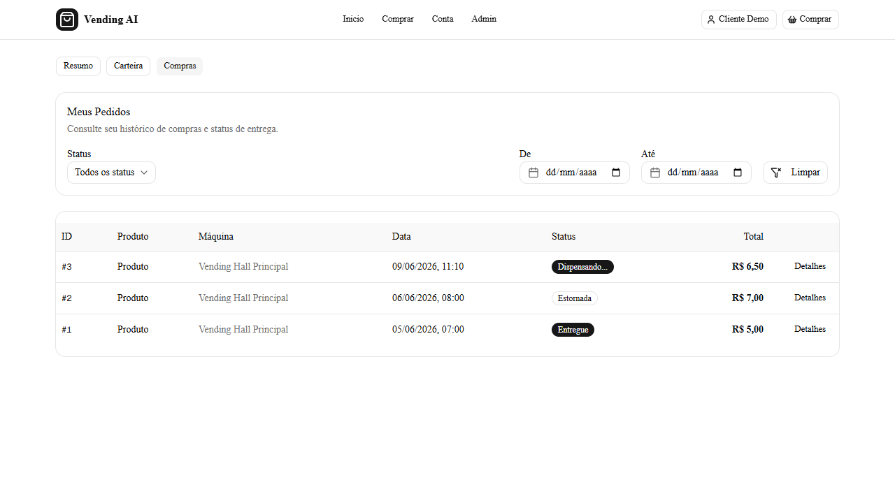

# Etapa 1 — escopo e base verificável

Etapa concluída em 2 de novembro de 2026. Escopo vigente: [especificação v2](../especificacao-plataforma-v2.md). A aplicação continua em http://localhost:3000.

## Entregas

- Especificação revisada com matriz do que será mantido, substituído e retirado.
- AGENTS.md, GEMINI.md, PRODUCT.md e README alinhados ao escopo autorizado; v1.0 identificada como histórica.
- Guias de autenticação, frontend e testes atualizados para distinguir o runtime de hoje das próximas etapas.
- [Inventário reproduzível](inventario.json): 47 rotas de API, 27 rotas frontend e 24 arquivos consumidores de API. Gerar novamente com node scripts/inventory.mjs a partir de web-platform. A extração é estática e não atesta a disponibilidade de cada endpoint.
- Backup anterior às alterações com código, configuração local, uploads e dumps dos dois bancos. [Procedimento de recuperação](../usage/backup-restauracao.md).

## Causas e correções

**Hidratação:** o hook inicializava estado React lendo localStorage. O servidor renderizava sessão vazia, mas a primeira renderização do cliente já tinha sessão e outro cabeçalho. A regressão de navegador reproduziu três erros React #418 na versão anterior. O hook agora usa useSyncExternalStore com snapshot inicial compartilhado entre SSR e hidratação e snapshot primitivo estável do storage. A recarga autenticada e as navegações completas passaram sem pageerror.

**Sincronização entre abas:** o listener anterior ignorava o evento storage com key nula, emitido por localStorage.clear(). O teste reproduziu a segunda aba permanecendo na conta após essa limpeza. A assinatura agora trata tanto a chave da sessão quanto limpeza completa, e remove os listeners ao desmontar.

**Lint:** foram removidos imports sem uso e casts any desnecessários. Formulários agora distinguem entradas/saídas Zod e usam useWatch nas assinaturas de campos. Cargas iniciadas em efeitos são agendadas como transições React, mantendo o estado de carregamento. A lista de slots do formulário de estoque é derivada da máquina selecionada e ignora respostas de seleções desmontadas. Nenhuma regra de lint foi desabilitada.

**Testes existentes:** seletores desatualizados de título da conta e painel foram alinhados à interface atual. Um novo seletor de busca administrativa foi tornado específico para distinguir a célula de imagem da célula de nome/SKU.

## Provas executadas

| Verificação | Resultado |
| --- | --- |
| Backend Jest/Supertest com NODE_ENV=test | 14 suítes, 96 testes aprovados |
| Build Next.js de produção no Docker | Aprovado, incluindo TypeScript |
| ESLint com --max-warnings=0 | Zero erros e avisos |
| TypeScript --noEmit | Aprovado |
| Navegador Chrome/Playwright | Seis cenários aprovados |
| Backup MySQL restaurado em instância isolada | 12 tabelas com checksums iguais à origem |
| Backup MongoDB restaurado em instância isolada | 455 documentos e cinco índices; zero falhas |
| Arquivo de código | Extraído e conferido contra o hook anterior |

Os seis cenários de navegador cobrem: fluxo de login/cadastro/logout e bloqueio de cliente no admin; recarga e navegação autenticadas sem erro de hidratação; logout/limpeza de storage entre abas; JSON de sessão inválido; API administrativa retornando 401 para visitante, 403 para cliente e 200 para ADMIN; busca de produto, checkbox controlado e validação de formulário administrativo sem gravar produto. Cinco passaram na rodada principal; o sexto passou após ajustar somente seu seletor ambíguo.

[Resumo estruturado](evidencias.json). Relatórios Playwright completos e traces locais ficam em .local/ na raiz do workspace. Os testes de cadastro criam usuário de demonstração identificado por auth.frontend.*, e os logs de acesso dos testes permanecem no MongoDB.

## Recuperação e limites

Os bancos restaurados usaram projeto Docker separado, sem portas ou rede e sem volumes da aplicação. Foram encerrados após a comparação; os backups locais permanecem. Checksums SHA-256 e detalhes das tabelas estão no arquivo privado restore-verification.json do backup. A captura MongoDB é independente do snapshot transacional MySQL.

A etapa 1 não retira MongoDB, altera saldos, reestrutura módulos ou conecta pagamentos externos. O link público Admin e a correção tipográfica ficam na etapa 3, junto com o novo sistema visual. Pagamento direto e política final da carteira continuam como propostas de transição para a etapa 6. A integração física não foi exercitada; o backend usa MQTT simulado nos testes.

## Repetir as verificações

A partir de web-platform, com os quatro serviços atuais ativos:

~~~bash
docker compose -f docker-compose.yml -f docker-compose.test.yml run --build --rm backend-tests
~~~

Na pasta frontend, com dependências instaladas e Chrome disponível:

~~~bash
npm run lint -- --max-warnings=0
npx tsc --noEmit
npm run build
npm run test:e2e -- --project=chromium
~~~

